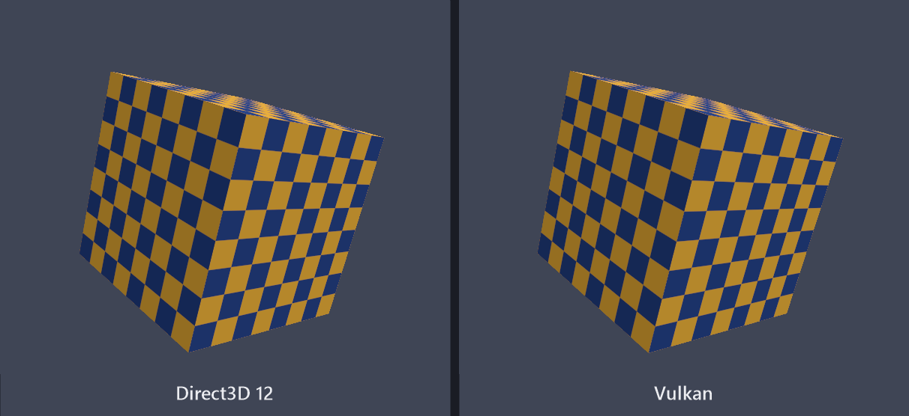

<p align="center">
  
</p>

<p align="center">
  <b>One C++ API. Three graphics APIs. No rewrite when you change your mind.</b>
</p>

<p align="center">
  
  
  
  
  
</p>

GFx is a render hardware interface. You write your renderer once, against GFx, and it runs on
Direct3D 12, Vulkan or Metal. You can even swap between them while the program is running. That's
mostly good for showing off, and occasionally for getting away from a driver that's having a bad
day.

This repository is where the **binary SDK** lives: the headers, the compiled library and a CMake
package. GFx's source code is kept somewhere else, safely tucked in.

<p align="center">
  
  <br>
  <sub>The same cube, drawn by the same code, on Direct3D 12 (left) and Vulkan (right). It's spinning, honest.</sub>
</p>

## Grab it

Head to [Releases](../../releases) and pick your platform:

| You're on | Download |
|---|---|
| Windows x64 | `GFx-<version>-windows-x64.zip` |
| Linux x64 | `GFx-<version>-linux-x64.tar.gz` |
| macOS, Apple silicon | Not built for 1.0.1. GFx speaks Metal fine; it just didn't get a ticket this time. |

Every release lists the SHA-256 of each archive, so CMake can check it got the right one.

## What's in the box

- **`include/gfx/`**: the public headers. Start with `gfx/device.h`. Every type and function is
  documented right there in the header, so you rarely need to leave your editor.
- **`bin/`** (Windows): `GFx.dll`, and `GFxd.dll` for Debug builds. They come with stripped PDBs,
  so a crash says `gfx::Device::submit` rather than `GFx.dll+0x3f2a1`.
- **`lib/`**: the import libraries on Windows, or `libGFx.so`. The CMake package is in
  `lib/cmake/GFx/`.
- **`share/doc/GFx/`**: the licence, and the notices for the open-source code compiled into GFx.

## Plugging it in

If the SDK is already unpacked somewhere, point `CMAKE_PREFIX_PATH` (or `GFx_DIR`) at it:

```cmake
find_package(GFx 1.0 REQUIRED CONFIG)
target_link_libraries(my_game PRIVATE GFx::GFx)
```

Or let CMake fetch it for you:

```cmake
include(FetchContent)
FetchContent_Declare(gfx_sdk
    URL      https://github.com/gpbeales/GFx-SDK/releases/download/v1.0.1/GFx-1.0.1-windows-x64.zip
    URL_HASH SHA256=<the hash from the release notes>)
FetchContent_MakeAvailable(gfx_sdk)
find_package(GFx 1.0 REQUIRED CONFIG PATHS "${gfx_sdk_SOURCE_DIR}" NO_DEFAULT_PATH)
```

Shaders are written in [Slang](https://shader-slang.org) and compiled at build time into ordinary
C++ headers, one per shader, ready for every backend:

```cmake
gfx_compile_shaders(TARGET my_game SOURCES shaders/mesh.slang)
```

That needs `slangc`, which comes with the [Vulkan SDK](https://vulkan.lunarg.com/sdk/home), or on
its own from [Slang's releases](https://github.com/shader-slang/slang/releases).

### One extra chore on Windows

Windows looks for DLLs next to the program, so copy GFx there after each build:

```cmake
add_custom_command(TARGET my_game POST_BUILD
    COMMAND "${CMAKE_COMMAND}" -E copy_if_different "$<TARGET_FILE:GFx::GFx>" "$<TARGET_FILE_DIR:my_game>"
    VERBATIM)
```

CMake picks `GFxd.dll` for Debug builds and `GFx.dll` for the rest. Don't mix them: Debug and
Release use different C++ runtimes, and they do not get along.

## Will it work with my compiler?

Probably. GFx passes standard-library types (`std::vector`, `std::function` and friends) across its
interface, so your program has to use the same kind of compiler and standard library as the SDK:

- **Windows**: Visual Studio 2022 or newer, x64. The SDK is built with MSVC and the usual `/MD`
  runtime.
- **Linux**: GCC 14 or newer, or Clang with libstdc++, and glibc 2.39 or newer (Ubuntu 24.04 and
  later). The SDK is built with GCC 14 on Ubuntu 24.04.

From 1.0, newer 1.x versions don't break your code. A newer patch release (1.0.1 to 1.0.5, say) can
even replace the DLL without a rebuild. A new minor version needs one.

## Small print

The SDK is free for noncommercial use, and that includes shipping the GFx DLL, unmodified, with your
game. Commercial use needs a separate licence from the author. The full terms are in
[LICENSE.md](LICENSE.md), and a copy is in every archive.

<p align="center"><sub>Made by Outlands. No triangles were harmed in the making of this SDK. A few were culled.</sub></p>
